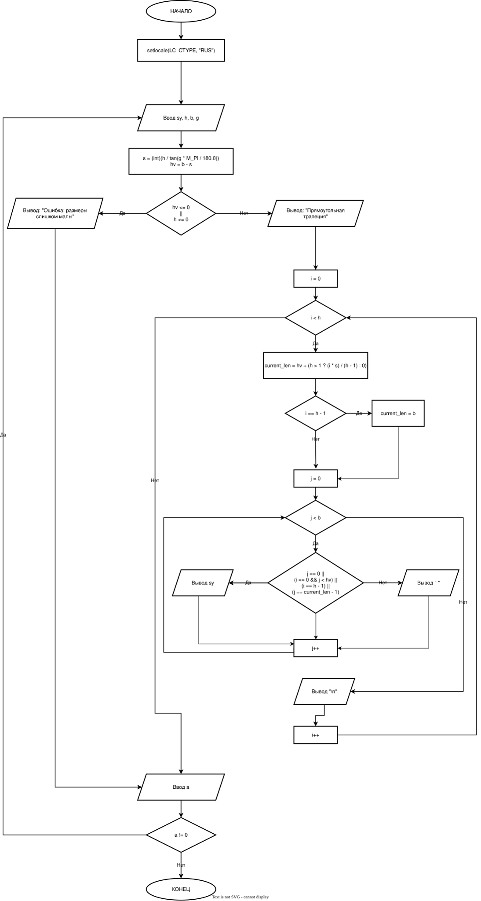

# Домашнее задание к работе 9
## Условие задачи
Написать программу, выводящую на экран заданную
геометрическую фигуру, нарисованную с помощью заданного с клавиатуры
символа, условие заполнения фигуры и задаваемые параметры фигуры в
таблице.

## Решение
Вот поэтапное решение с указанием на фрагменты кода:

1) Подключаем библиотеки.

2) Объявляем переменные.
  sy — символ рисования, h — высота, b — нижнее основание, g — угол, a — для повтора.

3) Начало цикла и ввод данных.
  Пользователь вводит все параметры трапеции.

4) Математические расчеты.
  int s = (int)(h / tan(g * M_PI / 180.0));
  int hv = b - s;
  s — смещение (сколько символов "съедает" наклон), hv — длина верхнего основания.

5) Проверка .
  Если верхнее основание или высота неположительные — выводится ошибка.

6) Рисунок.
  Цикл идет сверху вниз. current_len — длина текущей строки, плавно растет от hv до b.

7) Вывод символов в строке.
  Символ ставится на левой, верхней, нижней и правой наклонной стенках. Остальное — пробелы.

9) Повтор или выход.
  printf("Продолжить? (0 - нет, другое число - да): ");
  Если введен 0 — программа завершается, иначе цикл повторяется.

10) Конец.
### Блок - схема

# Выполнивший
ФИО: Рыженина Елизавета Павловна
Группа: БОТИ-261
